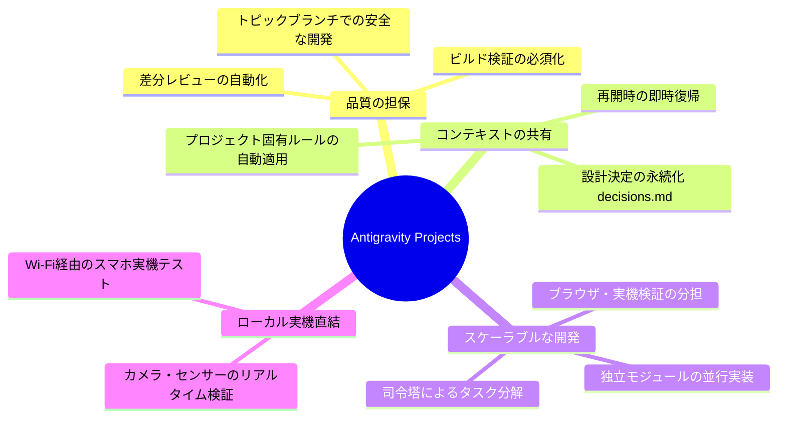
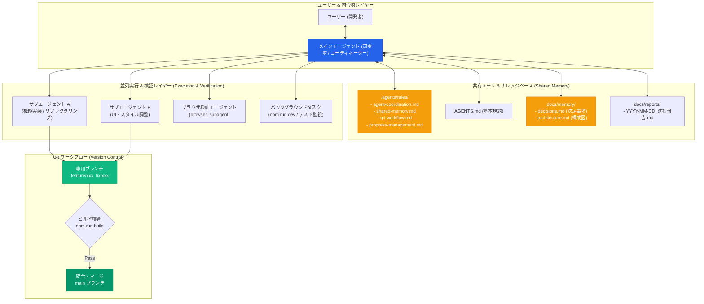
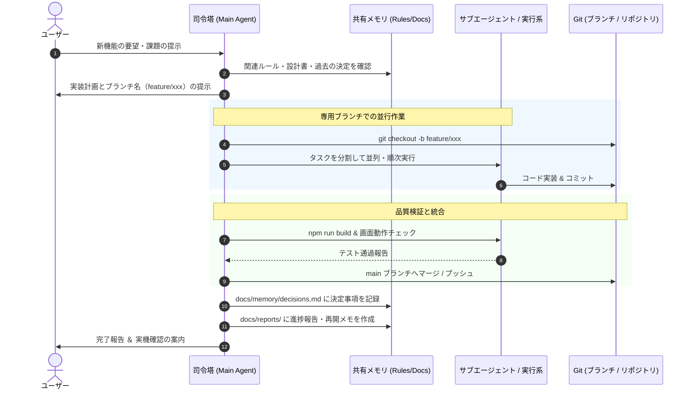

# Antigravity Projects 運用ガイドライン & 開発アーキテクチャ

> [!NOTE]
> 本ドキュメントは、Claude Code の Projects 機能に着想を得て、Antigravity（Google DeepMind）上で「司令塔・並列スレッド・共有メモリ・専用ブランチ管理」を実現・最適化するための基本方針、全体アーキテクチャ、および開発運用手順をまとめたマスターガイドです。
> Obsidian 保管庫への保存・閲覧に最適化されています。

---

## 1. 基本方針 (Philosophy)

本プロジェクトにおける開発体制は、**「司令塔（Coordinator）による統括 × 並列サブタスク自律実行 × 永続的共有メモリ × 厳格なブランチ分離」** を基本原則とします。

1. **自律性と規律の共存**
   - 単一のプロンプトで全てを書き換える「行き当たりばったりの実装」を廃止。
   - メインエージェントが全体像を把握し、作業単位を適切に分割して並行・順次実行します。
2. **コンテキストの恒久保持（忘却防止）**
   - セッションが終了したり会話が長大化しても、プロジェクトの設計思想・過去の技術判断・業務ルールを `.agents/rules/` や `docs/` に永続化し、常に再参照可能とします。
3. **ローカル密着型開発の最大活用**
   - クラウド完結型にはない Antigravity の最大の強みである「実機連携（Android等）」「ローカルHTTPS環境」「実ブラウザ検証」を開発サイクルに完全統合します。

---

## 2. 導入の目的と意図 (Objectives)



### 従来の単一会話開発との比較

| 項目 | 従来の単一会話開発 | Antigravity Projects 体制 |
| :--- | :--- | :--- |
| **指示構造** | 1つのチャット内で全てを直列指示 | **司令塔（メイン）がタスク分解し統括** |
| **作業範囲** | `main` ブランチに直接反映しがち | **機能ごとに専用ブランチ（`feature/...`）を自動作成** |
| **記憶（メモリ）** | 会話ログが流れると過去の決定を忘却 | **`AGENTS.md` / `rules/` / `docs/memory/` で永続共有** |
| **品質保証** | 人間が手動で画面確認 | **ビルド自動検査 ＋ ブラウザ自動検証（Subagent）** |
| **再開性** | 「前回どこまでやったか」の確認が必要 | **日次報告書（`docs/reports/`）による即時再開** |

---

## 3. 全体構成 (Overall Architecture)

### 3.1 システム階層図



### 3.2 共有メモリ（Shared Memory）の階層構造

エージェントが参照するメモリは、目的と更新頻度に応じて4階層に整理されています。

```
qr-scanner-app/
├── AGENTS.md                          # [最重要] エージェントの基本振る舞い・役割定義
├── .agents/
│   ├── rules/                         # プロジェクト固有の厳格な行動規範
│   │   ├── agent-coordination.md     # ① 司令塔と並列タスク運用の手順
│   │   ├── shared-memory.md          # ③ 共有メモリ・知識蓄積ルール
│   │   ├── git-workflow.md           # ④ 専用ブランチとPR・マージ規約
│   │   └── progress-management.md    # 進捗報告・再開手順の規約
│   └── skills/                        # 専門タスク用スクリプト・ツール集
│       └── progress-reporting/       # 日次・セッション報告自動生成スキル
└── docs/
    ├── architecture.md               # システム全体設計・コンポーネント相関
    ├── memory/
    │   └── decisions.md              # 過去の主要な技術選定・設計決定の記録
    └── reports/                       # 日次進捗報告書（Obsidian形式）
```

---

## 4. この Project を使用した開発の進め方 (Workflow)

開発は以下の **5つの標準ステップ** で進行します。



---

### ステップ別詳細手順

### Step 1: 要件受付とタスク分解（司令塔の初動）
- **ユーザーのアクション**: 「〇〇の機能を新設したい」「〇〇のバグを修正したい」と指示。
- **司令塔の動作**:
  1. `AGENTS.md` および `docs/memory/decisions.md` を読み込み、既存実装との整合性を確認。
  2. 大きなタスクを 2〜3 個の独立したサブタスクに分解。
  3. 作業専用のトピックブランチ名（例: `feature/pwa-support` や `fix/camera-selection`）を決定。

> [!TIP]
> **指示の出し方例**:
> 「履歴画面にCSVダウンロード機能を追加してください。ブランチを切って進めてください。」

---

### Step 2: 専用ブランチの作成と並列実装
- **ブランチの命名規則**:
  - 新機能追加: `feature/<機能名>` (例: `feature/export-csv`)
  - 不具合修正: `fix/<問題名>` (例: `fix/ios-video-blackout`)
  - ドキュメント整備: `docs/<内容>` (例: `docs/update-guide`)
  - リファクタリング: `refactor/<対象>` (例: `refactor/scanner-hooks`)
- **並列ワーカーの起動**:
  - 複数ファイルにまたがる場合や、調査・プロトタイプ検証が必要な場合は、司令塔がサブエージェント（`browser_subagent` 等）やバックグラウンドタスクを自律起動して作業を分担。

---

### Step 3: 品質検査・ローカル検証（ゲートキーパー）
変更をメインブランチにマージする前に、以下の **必須チェック** を自動実施します：

1. **静的検査 & ビルドチェック**:
   ```bash
   npm run build
   ```
   エラーや警告がないことを必ず確認。
2. **実ブラウザ / 実機検証**:
   - Web画面のレンダリング確認（`browser_subagent` によるスクリーンショット検証等）。
   - 必要に応じて Android 実機（`https://192.168.0.10:3000`）での動作確認をユーザーに依頼。

---

### Step 4: 統合（マージ）とコミット
- **Conventional Commits 規約**:
  - `feat: ...`（新機能）
  - `fix: ...`（バグ修正）
  - `docs: ...`（ドキュメントのみ）
  - `refactor: ...`（リファクタリング）
- テスト通過後、`main` ブランチへマージしてクリーンな状態を保ちます。

---

### Step 5: 共有メモリの更新と進捗報告
- 作業中に下した技術的判断（ライブラリ選定、非互換の回避策など）は、即座に `docs/memory/decisions.md` に追記。
- セッション終了時やキリの良いタイミングで `docs/reports/YYYY-MM-DD_[午前進捗報告|本日最終進捗報告].md` を自動生成し、次回再開手順を記録。

---

## 5. Claude Code Projects と Antigravity Projects の対比表

| 機能観点 | Claude Code Projects (Anthropic) | Antigravity Projects (DeepMind) | 現場での活用ポイント |
| :--- | :--- | :--- | :--- |
| **実行環境** | 完全クラウド型（Webコンテナ） | **ローカルマシン＋実シェル直結** | 実機デバッグやローカルHTTPS、特定ハードウェア連携は Antigravity が圧倒的に有利。 |
| **司令塔と並列性** | クラウド上の並列スレッド | **Coordinator ＋ Subagents / Tasks** | メイン会話が全体を指揮し、ブラウザ検証やコマンドを非同期実行。 |
| **共有メモリ** | プロジェクトナレッジ（Web設定） | **`.agents/rules/` ＋ `docs/memory/`** | リポジトリ内にMarkdownとして完全管理されるため、Gitでバージョン追跡可能。 |
| **ブランチ管理** | Web UI上での自動PR作成 | **Git CLI 完全制御（ブランチ/マージ自動化）** | チームや個人の運用に合わせたGitフロー（直接マージ、PR作成等）を自在に定義可能。 |
| **ドキュメント連携** | ツール内クローズド | **Obsidian / Markdown ネイティブ** | 日常的に使っているObsidian保管庫とシームレスに同期・蓄積可能。 |

---

## 6. まとめと今後の運用ルール

> [!IMPORTANT]
> **今後の開発における鉄則**:
> 1. 大きな機能改修は必ず **専用ブランチ（`feature/...`）** を作成して着手する。
> 2. 実装完了後は必ず **`npm run build`** でビルド整合性を担保する。
> 3. 設計判断や重要ルールはチャット内の会話で終わらせず、**`docs/memory/`** または **`rules/`** に必ず書き残す。
> 4. 作業終了時は **`docs/reports/`** に日次報告書を出力し、次回作業の再開手順を明記する。

このフレームワークにより、Claude Code のような「統括司令塔・並列作業・メモリ共有・専用ブランチ運用」が、ローカル密着の強みを活かしながら極めて高い精度で実現されます。
