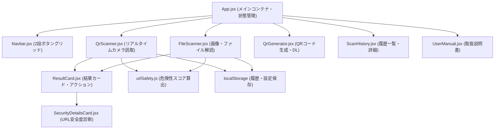

# アプリケーション・アーキテクチャ & システム構成

本ドキュメントは、QRコードスキャナーアプリのコンポーネント構成、データフロー、および主要技術スタックを記録する共有メモリです。

---

## 1. 全体構造図 (Component Hierarchy)

---

## 2. コンポーネントの責務一覧

| コンポーネント | 主な責務・役割 | 主要な依存ライブラリ / API |
| :--- | :--- | :--- |
| **`App.jsx`** | 画面切り替え（タブ状態）、履歴状態管理、設定（音/振動）管理 | React Hooks (`useState`, `useEffect`) |
| **`Navbar.jsx`** | 上段（スキャナー/ファイル）と下段（作成/履歴/取説）の切替UI | Lucide Icons |
| **`QrScanner.jsx`** | カメラデバイス列挙、リアルタイム映像取得、連続フレーム解析 | `BarcodeDetector`, `jsQR`, WebRTC |
| **`FileScanner.jsx`** | 画像ファイル選択、D&D、クリップボード貼付、画像前処理・解読 | `BarcodeDetector`, `jsQR`, Canvas API |
| **`ResultCard.jsx`** | スキャン結果表示、コピー、ブラウザオープン、LINE起動 | Lucide Icons, `window.open` |
| **`SecurityDetailsCard.jsx`** | URL安全スコアの内訳、プロトコル、ドメイン、危険警告表示 | `urlSafety.js` |
| **`QrGenerator.jsx`** | テキスト/URLからのQR画像生成、PNGダウンロード、カラー変更 | `qrcode.react` |
| **`ScanHistory.jsx`** | 過去スキャン履歴の一覧表示、再表示、クリア | `localStorage` |
| **`UserManual.jsx`** | 各機能の使い方、カメラ許可手順、トラブルシューティング解説 | Markdown風UI |

---

## 3. 主要データフロー

1. **スキャンフロー**:
   - カメラ映像 or 画像ファイル $\to$ `BarcodeDetector` (最優先) / `jsQR` (大津二値化フォールバック) $\to$ 生テキスト取得
2. **安全診断フロー**:
   - 生テキスト $\to$ `analyzeUrlSafety()` $\to$ URL構造解析・正規表現チェック（フィッシング・短縮URL・危険拡張子・LINE公式判定） $\to$ 安全スコア（0〜100点）と警告項目配列を生成
3. **履歴永続化フロー**:
   - スキャン成功 $\to$ 日時・種別・安全スコアを付与 $\to$ `localStorage` の `qr_scan_history` キーにJSON保存
